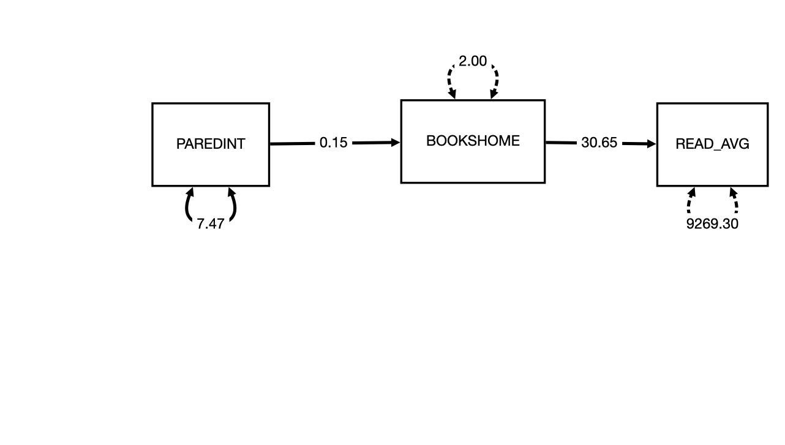
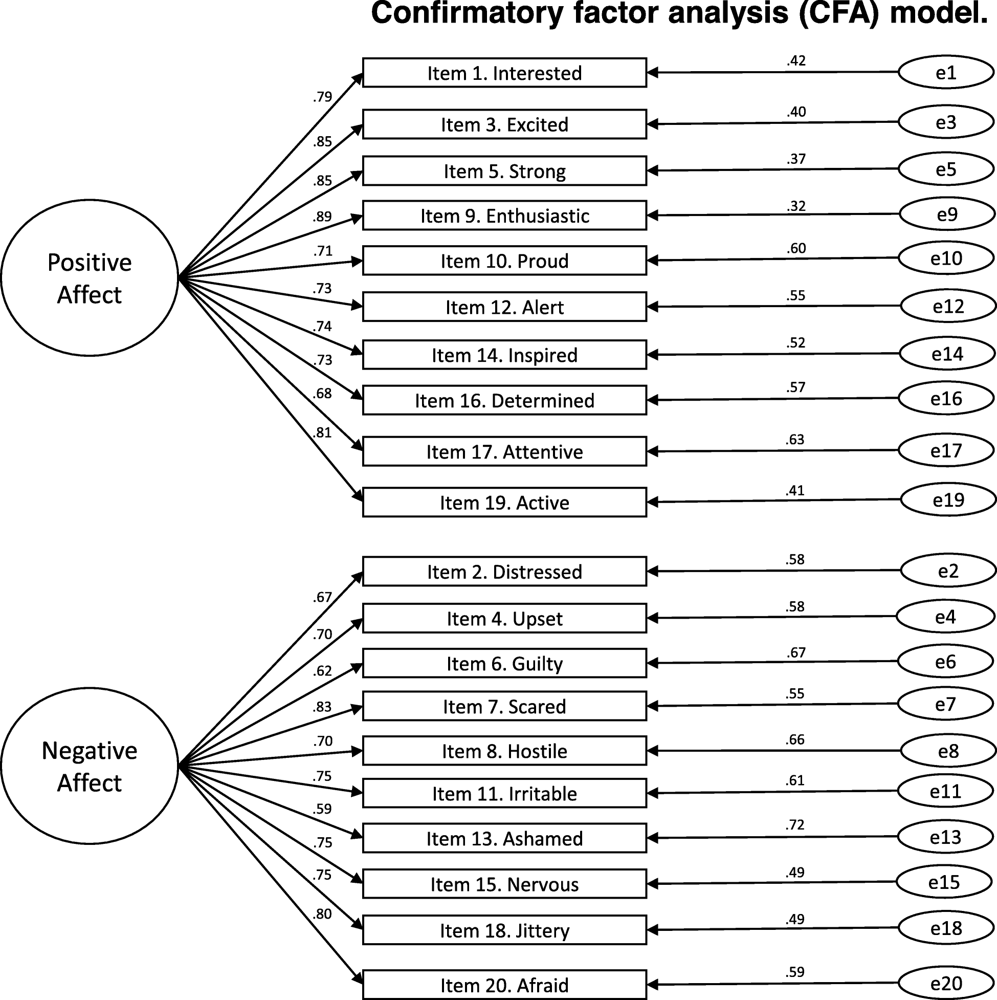
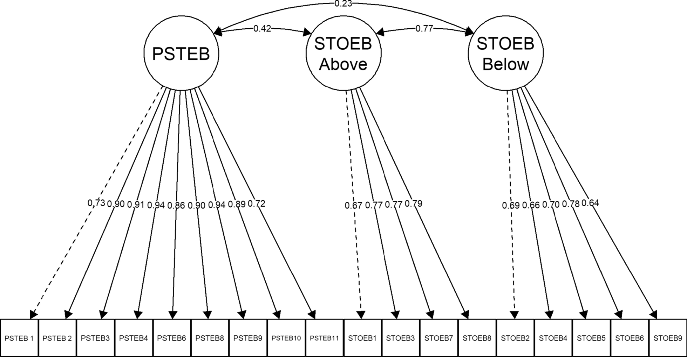

# Agenda

- Review: Global fit
- Interpretation
- Modification indices
- Mini Project 2
- CFA assumptions
- Rlab: Interpreting different models


# Global Fit Review

Lamaku > quizzes > Model Fit Review

- Repeat until you get it right
- 5 minutes; max 5 attempts

# Review 🤸

::: {.content-visible when-profile="teacher"}
::: {.fragment}

H0: model-implied covariance matrix = observed matrix
    
    - failure to reject H0 supports our hypothesis 
    - Non-significant result means we fail to reject H0. 🎉
:::
:::

::: {.content-visible when-profile="teacher"}
::: {.fragment}

H1: Model implied covariance matrix is NOT equivelant to observed

    - reject H0, accept H1. This does NOT support our hypothesis
    - Significant result means we reject H0 😢

:::
:::

# Global Fit & Interpretation

How close the model-implied covariance matrix is to the observed matrix

- If poor, the model doesn't describe the data well 
  - don't interpret 
- If good, the model DOES describe the data well 
  - interpret
  - Does NOT mean it is the **ONLY** model that fits the data well

# Interpretation

## What makes a good latent variable? 

It matches what theory predicts:

- Convergent validity: Indicators of a latent variable share variance through (and only through) that latent variable
- Discriminant validity: Different latent variables represent distinct constructs


## Tools for Interpretation {.smaller}

:::: {.columns}

::: {.column width="34%"}
**Core interpretation**

- Path coefficients/loadings
- Residual variances
- AVE
- Reliability
:::

::: {.column width="33%"}
**Multi-factor**

- Factor correlations
- Cross loadings
- Modification indices
- Residual correlations
:::

::: {.column width="33%"}
**Future**

- Intercepts
- Factor means
:::

::::

## Review: 

What did path coefficients mean in MVPA?



::: {.content-visible when-profile="teacher"}
::: {.fragment}

- Each 1-unit increase in parent education is associated with a 0.15-unit increase in books at home, in the units of books.
:::
:::

::: {.content-visible when-profile="teacher"}
::: {.fragment}

- Each 1-unit increase in books at home is associated with a 30.65-point increase in reading score, in the units of the reading score.
:::
:::

::: {.content-visible when-profile="teacher"}
::: {.fragment}

- The indirect effect of parent education on reading score through books at home is 0.15 × 30.65 = 4.60. Each 1-unit increase in parent education is associated with a 4.60-point increase in reading score through books at home.

:::
:::


## CFA Path coefficients/Loadings (stand.)

Technicaly the same:

- indicator is expected to rise by [loading/path coefficient] * item SD per 1 SD increase in the factor. 

In reality

-  we care about the strength of the loadings/path coefficients & alignment to theory
- Generally interpret standardized in reporting but report both in charts, etc. 

## Path coefficients/Loadings

| Strength   | Standardized loading / path  |
|:-----------|:-----------------------------|
| Strong     | \|0.7\| and higher           |
| Acceptable | \|0.5\| to \|0.7\|           |
| Weak       | less than \|0.4\|            |

## Path coefficients/loadings

- Significance indicates loading/path coefficent is distinguishable from 0
- Direction: should* match what theory predicts
- Normal to have lower/higher in the acceptable range 
    - should* align with theoretical predictions about how important
- In simple structure, [lambda] squared is the share of inidcator variance the factor explains

*If not, highlight/discuss

## Heywood cases 🚩

- Standardized Loadings > 1
- Negative residual variances
- Too few indicators per factor

Indicate problem with model or sample size

## Example: Single-factor model

```{r}
#| label: ach-run
#| echo: false
#| message: false
#| ref.label: ach-model
```

```{r}
#| label: ach-diagram
#| echo: false
#| message: false
#| fig-width: 10
#| fig-height: 5
#| fig-align: center
library(semPlot)
semPaths(ach_fit, what = "path", whatLabels = "name", style = "lisrel",
         layout = "tree", rotation = 1, residuals = TRUE, intercepts = FALSE,
         nCharNodes = 0, sizeMan = 11, sizeMan2 = 5, sizeLat = 10,
         edge.label.cex = 1, edge.color = "black",
         color = list(lat = "lightblue", man = "white"), mar = c(4, 4, 4, 4))
```

## Example: Single-factor model (code)

```{r}
#| label: ach-model
#| echo: true
#| eval: false
library(lavaan)
library(tidyverse)

ach_dat <- read_csv("../rlabs/w08_data_pisa22_USA_cln_cfa.csv",
                    show_col_types = FALSE) |>
  select(READING_AVE, MATH_AVE, SCIENCE_AVE, STUDYHMW) |>
  drop_na()

ach_model <- 'ach =~ READING_AVE + MATH_AVE + SCIENCE_AVE + STUDYHMW'

ach_fit <- lavaan(ach_model, data = ach_dat,
                  std.lv = TRUE,          # factor variance fixed to 1
                  auto.fix.first = FALSE, # don't fix first loading to 1
                  auto.var = TRUE,        # estimate residual variances
                  estimator = "ML")

std_sol <- standardizedSolution(ach_fit)
```

## Example: Global fit {.smaller .scrollable}

```{r}
#| label: ach-fit
#| echo: false
summary(ach_fit, fit.measures = TRUE)
```

## Example: Standardized path coefficients {.smaller}

```{r}
#| label: ach-paths
#| echo: false
#| results: asis
show_rows <- function(x, rows) {
  txt <- capture.output(print(x))
  idx <- rows + 1  # line 1 is the header
  esc <- htmltools::htmlEscape(txt)
  before <- esc[seq_len(min(idx) - 1)]
  box <- esc[idx]
  after <- esc[-seq_len(max(idx))]
  cat('<pre class="hl-out">',
      paste(before, collapse = "\n"), "\n",
      '<div style="border:3px solid #d62728;border-radius:4px;',
      'padding:0 .3em;margin:0 -.3em;">',
      paste(box, collapse = "\n"), "</div>",
      paste(after, collapse = "\n"), "</pre>", sep = "")
}
show_rows(standardizedSolution(ach_fit), 1:4)
```

- Rows with `=~` indicate the loadings/path coefficients

## Example: Standardized path diagram

```{r}
#| label: ach-std-diagram
#| echo: false
#| message: false
#| fig-width: 10
#| fig-height: 5.5
#| fig-align: center
std_ach <- standardizedSolution(ach_fit)
add_stars <- function(p) {
  ifelse(p < .001, "***", ifelse(p < .01, "**", ifelse(p < .05, "*", "")))
}
std_ach$lab <- paste0(formatC(std_ach$est.std, digits = 2, format = "f"),
                      add_stars(std_ach$pvalue))
lab_key <- setNames(std_ach$lab,
                    ifelse(std_ach$op == "=~",
                           paste(std_ach$rhs, std_ach$lhs),
                           paste(std_ach$lhs, std_ach$rhs)))

ach_plot <- semPaths(ach_fit, what = "path", whatLabels = "name",
                     style = "lisrel", layout = "tree", rotation = 1,
                     residuals = TRUE, intercepts = FALSE, nCharNodes = 0,
                     sizeMan = 11, sizeMan2 = 5, sizeLat = 10,
                     edge.label.cex = 1, edge.color = "black",
                     color = list(lat = "lightblue", man = "white"),
                     mar = c(4, 4, 4, 4), DoNotPlot = TRUE)
node_nm <- ach_plot$graphAttributes$Nodes$names
edges <- ach_plot$Edgelist
ach_plot$graphAttributes$Edges$labels <- sapply(
  seq_along(edges$from), function(i) {
    a <- node_nm[edges$from[i]]
    b <- node_nm[edges$to[i]]
    lab <- lab_key[paste(b, a)]
    if (is.na(lab)) lab <- lab_key[paste(a, b)]
    unname(lab)
  })
plot(ach_plot)
```

\* p < .05, \*\* p < .01, \*\*\* p < .001

## Residual variances

- Random measurement error
- Indicator-specific variance not shared with the factor
- low residuals should go with strong path coefficients/loadings and vice versa
- high residuals should go with low path coefficients/loadings
- Correlated residuals indicates that the indicators share variance unrelated to the factor

## Example: Standardized residual variances {.smaller}

```{r}
#| label: ach-resid
#| echo: false
#| results: asis
show_rows(standardizedSolution(ach_fit), 5:8)
```

- Rows 4--6 (`~~` on an indicator): the standardized residual variances

- Residual = 1 − loading², the share of indicator variance the factor does not explain
- Science has the strongest loading and the smallest residual
- All residuals are positive: no Heywood cases

## factor correlations

How correlated are the constructs? 

- Moderate correlation (r = 0.3--.7) generally suggests distinct but related constructs
    - the direction should match theorized relationship
- Higher suggests they are not distinguishable or may be one construct
- lower: fine if no relationship predicted

## Example

No example: Only one factor

## Latent-variable level indicator: AVE

- Average variance extracted
- average proportion of the indicators' variance the factor captures
- ave > 0.5 inidcates more variance in indicators is explained (on average) than unexplained  

## Example: AVE (code)

$$AVE = \frac{\sum \lambda_i^2}{k}$$

```{r}
#| label: ach-ave
#| echo: true
#| output: false
loadings <- std_sol$est.std[std_sol$op == "=~"]
ave <- mean(loadings^2)
```

## Example: AVE

```{r}
#| label: ach-ave-out
#| echo: false
loadings^2
ave
```

- AVE = `r sprintf("%.3f", ave)`, well above the 0.5 benchmark
- The factor captures about `r round(100 * ave)`% of the indicators' variance

## Example: Reliability (code)

$$\omega = \frac{(\sum \lambda_i)^2}{(\sum \lambda_i)^2 + \sum \theta_i}$$

```{r}
#| label: ach-omega
#| echo: true
#| output: false
resid_var <- std_sol$est.std[std_sol$op == "~~" &
                               std_sol$lhs == std_sol$rhs &
                               std_sol$lhs != "ach"]
omega <- sum(loadings)^2 / (sum(loadings)^2 + sum(resid_var))
```

## Example: Reliability

```{r}
#| label: ach-omega-out
#| echo: false
sum(loadings)^2
sum(resid_var)
omega
```

- $\omega$ = `r sprintf("%.3f", omega)`, above the common 0.70 benchmark
- About `r round(100 * omega)`% of the composite's variance is true factor variance

# Interpretation: More complicated model

## Example: Two-factor model (path diagram)

```{r}
#| label: two-run
#| echo: false
#| message: false
#| ref.label: two-model
```

```{r}
#| label: two-diagram
#| echo: false
#| message: false
#| fig-width: 10
#| fig-height: 5
#| fig-align: center
library(semPlot)
semPaths(two_fit, what = "path", whatLabels = "name", style = "lisrel",
         layout = "tree", rotation = 1, residuals = TRUE, intercepts = FALSE,
         nCharNodes = 0, sizeMan = 11, sizeMan2 = 5, sizeLat = 10,
         edge.label.cex = 1, edge.color = "black",
         color = list(lat = "lightblue", man = "white"), mar = c(4, 4, 4, 4))
```

## Example: Two-factor model (code)

```{r}
#| label: two-model
#| echo: true
#| eval: false
ses_dat <- read_csv("../rlabs/w08_data_pisa22_USA_cln_cfa.csv",
                    show_col_types = FALSE) |>
  select(PARENTED, BOOKSHOME, TECHHOME,
         READING_AVE, MATH_AVE, SCIENCE_AVE) |>
  mutate(TECHHOME = na_if(TECHHOME, 99)) |>  # 99 = missing code
  drop_na() |>
  mutate(across(everything(), \(x) as.numeric(scale(x))))

two_model <- '
  ses =~ PARENTED + BOOKSHOME + TECHHOME
  ach =~ READING_AVE + MATH_AVE + SCIENCE_AVE
'

two_fit <- lavaan(two_model, data = ses_dat,
                  std.lv = TRUE,          # factor variances fixed to 1
                  auto.fix.first = FALSE, # don't fix first loadings to 1
                  auto.var = TRUE,        # estimate residual variances
                  auto.cov.lv.x = TRUE,   # estimate factor covariance
                  estimator = "ML")

two_std <- standardizedSolution(two_fit)
```

## Example: Global fit {.smaller .scrollable}

```{r}
#| label: two-fit
#| echo: false
summary(two_fit, fit.measures = TRUE)
```

- $N$ = `r nobs(two_fit)`
- $\chi^2$ is significant, but with a large $N$ that is expected
- CFI > .95, SRMR < .08, RMSEA near .05: good fit, so we can interpret

## Example: Standardized path diagram

```{r}
#| label: two-std-diagram
#| echo: false
#| message: false
#| fig-width: 10
#| fig-height: 5.5
#| fig-align: center
std_two <- standardizedSolution(two_fit)
add_stars <- function(p) {
  ifelse(p < .001, "***", ifelse(p < .01, "**", ifelse(p < .05, "*", "")))
}
std_two$lab <- paste0(formatC(std_two$est.std, digits = 2, format = "f"),
                      add_stars(std_two$pvalue))
lab_key2 <- setNames(std_two$lab,
                     ifelse(std_two$op == "=~",
                            paste(std_two$rhs, std_two$lhs),
                            paste(std_two$lhs, std_two$rhs)))

two_plot <- semPaths(two_fit, what = "path", whatLabels = "name",
                     style = "lisrel", layout = "tree", rotation = 1,
                     residuals = TRUE, intercepts = FALSE, nCharNodes = 0,
                     sizeMan = 11, sizeMan2 = 5, sizeLat = 10,
                     edge.label.cex = 1, edge.color = "black",
                     color = list(lat = "lightblue", man = "white"),
                     mar = c(4, 4, 4, 4), DoNotPlot = TRUE)
node_nm2 <- two_plot$graphAttributes$Nodes$names
edges2 <- two_plot$Edgelist
two_plot$graphAttributes$Edges$labels <- sapply(
  seq_along(edges2$from), function(i) {
    a <- node_nm2[edges2$from[i]]
    b <- node_nm2[edges2$to[i]]
    lab <- lab_key2[paste(b, a)]
    if (is.na(lab)) lab <- lab_key2[paste(a, b)]
    unname(lab)
  })
plot(two_plot)
```

\* p < .05, \*\* p < .01, \*\*\* p < .001

## Example: Standardized path coefficients {.smaller}

```{r}
#| label: two-paths
#| echo: false
#| results: asis
show_rows(standardizedSolution(two_fit), 1:6)
```

- Rows 1--6 (`=~`): the standardized loadings

## Example: Standardized residual variances {.smaller}

```{r}
#| label: two-resid
#| echo: false
#| results: asis
show_rows(standardizedSolution(two_fit), 7:12)
```

- Rows 7--12 (`~~` on an indicator): the standardized residual variances

## Example: Factor correlation {.smaller}

```{r}
#| label: two-cor
#| echo: false
#| results: asis
show_rows(standardizedSolution(two_fit), 15)
```

- Row 15 (`ses ~~ ach`): the factor correlation

## Example: AVE (code)

```{r}
#| label: two-ave
#| echo: true
#| output: false
two_load <- two_std[two_std$op == "=~", ]
two_ave <- tapply(two_load$est.std^2, two_load$lhs, mean)
two_r2 <- two_std$est.std[two_std$op == "~~" & two_std$lhs == "ses" &
                            two_std$rhs == "ach"]^2
```

## Example: AVE

```{r}
#| label: two-ave-out
#| echo: false
two_ave
two_r2
```

## Example: Reliability (code)

```{r}
#| label: two-omega
#| echo: true
#| output: false
two_resid <- two_std[two_std$op == "~~" & two_std$lhs == two_std$rhs &
                       two_std$lhs %in% two_load$rhs, ]
two_theta <- two_resid$est.std[match(two_load$rhs, two_resid$lhs)]
sum_lam <- tapply(two_load$est.std, two_load$lhs, sum)
sum_theta <- tapply(two_theta, two_load$lhs, sum)
two_omega <- sum_lam^2 / (sum_lam^2 + sum_theta)
```

## Example: Reliability

```{r}
#| label: two-omega-out
#| echo: false
two_omega
```


# Practice

Review the following examples and interpret the results. 

1. How is the convergent validity? 
2. How is the divergent validity? 
3. Are there any variables that don't appear to align with theory? 

# Practice 1: 

Díaz-García, Amanda, et al. “Positive and Negative Affect Schedule (PANAS): Psychometric Properties of the Online Spanish Version in a Clinical Sample with Emotional Disorders.” BMC Psychiatry [London], vol. 20, no. 1, no. 56, February 2020, https://doi.org/10.1186/s12888-020-2472-1.

- Positive and Negative Affect Schedule (PANAS), a scale to assess positive and negative affect
- Loadings shown are standardized
- Assume good model fit

## Practice 1: Path diagram

{fig-align="center"}

# Practice 2: 

Unfried, Alana, et al. “An Alternative to STEBI-A: Validation of the T-STEM Science Scale.” International Journal of STEM Education [Cham], vol. 9, no. 1, no. 24, March 2022, https://doi.org/10.1186/s40594-022-00339-x.

- In-service teacher scale for self-efficacy
- PSTEB: personal science teaching efficacy beliefs 
- STOEB: science teaching outcome expectancy beliefs
  - STOEB above-average student interest and outcome
  - STOEB below-average student interest and outcome

# Practice 2 Path diagram:

{fig-align="center"}

# Unstandardized Path coefficients

If variance in latent variable is fixed to 1: 

- change in unit per one-unit change in latent variable

If variance in first loading is fixed to 1: 

- LV units becomes units of what moves the indicator by one point

# CFA Assumptions

- Adequate sample size: 10 cases / parameter or 200
- Continuous indicators with multivariate normality (or change estimators, etc)
- Linear relationships
- Missing data are MCAR or MAR
- No extreme multicollinearity or singularity
- No problematic outliers
- Independent observations

# What if model fit is poor?

- Before you run the model, define alternative models that are theory driven

## Modification Indices

- A data (not theory) driven approach
- tells us how much freeing paramters in the model would decrease x2
- Useful as a guide, but MUST be supported by theory

## Modification indices example

```{r}
#| label: mi-model
#| echo: false
library(lavaan)
library(semPlot)
library(tidyverse)

mi_dat <- read_csv("../rlabs/w08_data_pisa22_USA_cln_cfa.csv",
                   show_col_types = FALSE) |>
  select(PARENTED, BOOKSHOME, TECHHOME,
         READING_AVE, MATH_AVE, SCIENCE_AVE) |>
  drop_na() |>
  mutate(across(everything(), \(x) as.numeric(scale(x))))

mi_model <- '
  ses =~ PARENTED + BOOKSHOME + TECHHOME
  ach =~ READING_AVE + MATH_AVE + SCIENCE_AVE
'
mi_fit <- cfa(mi_model, data = mi_dat, std.lv = TRUE)
```

```{r}
#| label: mi-diagram
#| echo: false
#| fig-width: 10
#| fig-height: 5
#| fig-align: center
semPaths(cfa(mi_model, data = mi_dat, std.lv = TRUE, do.fit = FALSE),
         what = "path", whatLabels = "name", style = "lisrel",
         layout = "tree", rotation = 1, residuals = TRUE, intercepts = FALSE,
         nCharNodes = 0, sizeMan = 11, sizeMan2 = 5, sizeLat = 10,
         edge.label.cex = 1, edge.color = "black",
         color = list(lat = "lightblue", man = "white"), mar = c(4, 4, 4, 4))
```

## Modification Indices Outputs

```{r}
#| label: mi-table
#| echo: false
mi_tab <- modindices(mi_fit, sort. = TRUE, maximum.number = 10) |>
  select(lhs, op, rhs, mi, epc, sepc.all)
knitr::kable(mi_tab, digits = 3, col.names = c("lhs", "op", "rhs", "MI", "EPC", "std EPC"))
```

```{=html}
<style>
#modification-indices-outputs table { font-size: 0.55em; }
</style>
```

# Up Next

- Methods walkthrough


